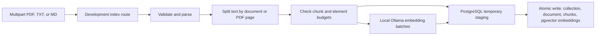
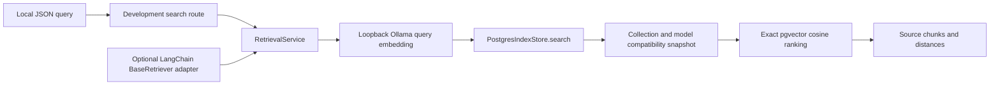

# Codebase map

This map describes Phases 1–6 and 8 on `main`, plus Phase 9A.1 source metadata persistence on `feat/multimodal-evidence-storage`. Check the linked code when changing behavior; [architecture decisions](ARCHITECTURE_DECISIONS.md) explain the broader direction and [the roadmap](ROADMAP.md) separates later phases.

## Entry points and boundaries

| Area | Current responsibility |
| --- | --- |
| [`src/rag_ai/main.py`](../src/rag_ai/main.py) | `create_app()` builds FastAPI, stores validated settings, always registers `/health`, and conditionally registers parse/chunk, index, search, answer, and Phase 8 visual routes. |
| [`src/rag_ai/core/config.py`](../src/rag_ai/core/config.py) | Pydantic settings load environment values, validate resource limits and the loopback Ollama URL, and reject production route opt-in. |
| [`src/rag_ai/api/`](../src/rag_ai/api/) | `/health` is process liveness. `documents.py` handles parse/chunk/index uploads, `retrieval.py` handles search, `answers.py` handles cited answers, and Phase 8 `visual.py`/`vision.py` handle inspection, preview, and local analysis. Phase 9A.1 `visual_elements.py` indexes and lists stored source regions. Document access routes are development-only and disabled by default. |
| [`src/rag_ai/documents/`](../src/rag_ai/documents/) | `parser.py` validates uploads and extracts text; `chunker.py` uses LangChain's `RecursiveCharacterTextSplitter`; `indexer.py` coordinates bounded embedding batches and storage. |
| [`src/rag_ai/embeddings/`](../src/rag_ai/embeddings/) | `base.py` defines an `EmbeddingProvider` protocol and batch model; `ollama.py` implements local embeddings through Ollama HTTP. |
| [`src/rag_ai/retrieval/`](../src/rag_ai/retrieval/) | `service.py` embeds and validates one query, `models.py` defines results, `langchain.py` adapts the service to `BaseRetriever`, and `evaluation.py` scores ranked IDs. |
| [`src/rag_ai/generation/`](../src/rag_ai/generation/) | Typed structured-output contract and local Ollama `/api/chat` provider. |
| [`src/rag_ai/rag/`](../src/rag_ai/rag/) | Bounded evidence context, prompt instructions, and single-turn retrieval/generation/citation coordination. |
| [`src/rag_ai/vision/`](../src/rag_ai/vision/) | Phase 8 typed local VLM boundary and application-owned visual evidence; it does not write to PostgreSQL or produce text-RAG citations. |
| [`src/rag_ai/storage/`](../src/rag_ai/storage/) | `postgres.py` writes text records and performs exact cosine search. `visual.py` atomically replaces collection-scoped visual occurrences. `migrate.py` and SQL migrations `0001`/`0002` provide explicit versioned schema commands. |

## Implemented indexing flow

The route in `api/documents.py` reads at most the upload limit plus one byte, then calls `parse_document`, `chunk_document`, and `index_document`. The parser checks filename/MIME declarations, PDF structure or UTF-8 decoding, page count, and extracted-text length (including PDF page separators); image-only PDFs need OCR, which is not implemented. `ParsedDocument` hashes the original bytes for a stable document ID. `ChunkedDocument` uses LangChain splitting, keeps each PDF page separate, and hashes document ID, page, chunk index, text, and settings for stable chunk IDs. TXT/Markdown chunks have no page number. The indexer probes actual dimensions with a first batch of at most 16, checks the total element budget, then streams remaining batches to `PostgresIndexStore`. LangChain may still materialize a full split list for one source before the final chunk-count check.

`OllamaEmbeddingProvider` checks the local model digest through `/api/tags` and obtains vectors through `/api/embed`. It validates model identity, revision, dimensions, and finite vector values. The digest prevents a changed model under the same name from silently sharing an embedding space; measured dimensions prevent incompatible pgvector comparisons. `PostgresIndexStore` uses parameterized SQL and a connection-local temporary table for bounded batches. Only the final transaction replaces one document's permanent chunks and embeddings within its collection, so a failed batch or final write leaves the prior index intact. The schema stores original bytes and model metadata; composite foreign keys bind chunks and vectors to their collection. Storage-layer `delete_document` transactionally deletes one collection/document pair and cascades its derived rows, but there is no HTTP deletion route or automatic retention expiry. Migrations run only through explicit CLI commands, never during API startup.

## Implemented retrieval flow

`api/retrieval.py` calls the synchronous service in a threadpool and closes the Ollama provider after each request. The service validates exactly one finite, nonzero query vector and passes its measured model name, digest, and dimensions to the existing store. The store checks **indexed embeddings**, then ranks only materialized, same-dimension, same-model, nonzero candidates in one read-only repeatable-read snapshot; the filter must precede `<=>` because stored vectors may have mixed dimensions. It fetches chunk text only for top ranked IDs. SQL joins and filters include `collection_id`; ties use document/chunk identifiers for deterministic ordering. Results carry filename and PDF page metadata but no raw vectors. The LangChain adapter delegates to the same service rather than searching independently. `evaluation.py` calculates Recall@K, Hit@K, and MRR from actual ranked IDs; the separate nine-document synthetic fixture tests ranking at K=1 and K=3.

Migrations do not run at API startup. `python -m rag_ai.storage status|upgrade|adopt-legacy` invokes the migration runner; version 2 is required by this branch. Existing version-1 and unversioned databases require a verified backup and separately authorized upgrade or adoption. See [database migrations](DATABASE_MIGRATIONS.md).

## Trust boundaries and tests

Uploads, filenames, MIME types, PDF structure, Ollama responses, and database state cross trust boundaries. The provider accepts loopback HTTP only and rejects redirects; there is no cloud fallback. Development route gating is **not** authentication or collection authorization. Keep these routes on a trusted localhost machine; see the [security test plan](SECURITY_TEST_PLAN.md).

Use `tests/test_health.py` and `tests/test_document_gate.py` for routing and configuration gates; `tests/test_documents.py` for parsing; `tests/test_chunking.py` for splitting; `tests/test_embeddings.py` for provider/indexer behavior; `tests/test_retrieval.py` for service, adapter, and API behavior; and `tests/test_retrieval_evaluation.py` for metrics. `tests/test_storage_lifecycle.py`, `tests/test_indexing_integration.py`, and `tests/test_retrieval_integration.py` cover opt-in PostgreSQL/Ollama paths. `tests/conftest.py` creates disposable schemas for live database tests. The default suite skips those tests without the explicit test database setting.

The local 2026-10-29 run used the dedicated `rag_ai_retrieval_test` database and `embeddinggemma:300m`: seven retrieval integration tests and the five-test expanded evaluation module passed. The full suite passed 168 tests with no skips. This validates the current Linux setup only; it does not establish cross-platform or production behavior.

## Implemented cited-answer flow

`api/answers.py` runs `RAGService.answer()` in a threadpool and closes both providers. `RAGService` reuses `RetrievalService`; `rag/context.py` assigns request-local labels to ranked chunks and rejects overlong evidence rather than truncating it. `rag/prompts.py` presents untrusted content as delimited evidence. `generation/ollama.py` requests JSON-schema output from local Ollama, validates the returned status and claims, and bounds the response. `RAGService` resolves cited labels to retrieval metadata and rejects unknown labels. Empty retrieval abstains without generation. The application verifies provenance, not entailment. `tests/test_generation.py`, `tests/test_rag_service.py`, `tests/test_answer_api.py`, and opt-in `tests/test_rag_integration.py` cover this flow with synthetic data.

## One end-to-end path

**PDF → `documents/parser.py` → `documents/chunker.py` → `documents/indexer.py` → `embeddings/ollama.py` → `storage/postgres.py` → `retrieval/service.py` → `rag/context.py` → `generation/ollama.py` → `rag/service.py` → cited answer.** Upload and question enter through separate routes. The answer route closes both providers after use, and `rag/service.py` resolves model-supplied labels against the retrieved chunks. An empty retrieval or valid model abstention returns `insufficient_evidence`; a citation identifies a source but does not prove its claim.

The merged opt-in [`tests/test_local_rag_e2e.py`](../tests/test_local_rag_e2e.py) follows a synthetic two-page PDF through real FastAPI routes, local Ollama, and an isolated PostgreSQL schema; it checks page citations, abstention, and collection filtering. `tests/test_rag_service.py` and `tests/test_answer_api.py` cover controlled failures without live services. The E2E fixture verifies the exact loopback `rag_ai_retrieval_test` destination before schema creation; **other** integration fixtures do not enforce that exact-database preflight. See the [local testing guide](LOCAL_RAG_TESTING.md) for prerequisites, historical results, and test commands. Collection filtering is not caller authorization.

## Phase 8 visual flow on main

`documents/visual.py` inspects raster occurrences, PyMuPDF vector paths, and heuristic tables in displayed-page PDF points. Clipped boxes omit invisible portions, while counts include off-page items. Vector paths are not semantic diagrams. `documents/render.py` renders one bounded region to PNG in memory; `api/visual.py` exposes inspection and preview under the visual-inspection flag.

`api/vision.py` accepts one PDF page/region or validated PNG/JPEG upload. `vision/ollama.py` sends bounded images only to loopback Ollama. `vision/evidence.py` assigns source IDs and locations from the input; model descriptions are unverified observations. The Phase 8 routes do not write to PostgreSQL.

## Phase 9A.1 source metadata flow

`api/visual_elements.py` separately gates POST indexing and paginated GET listing for already indexed PDFs. `storage/visual.py` reads and verifies the stored PDF; `documents/visual_elements.py` adapts Phase 8 inspection into strict candidates with normalized displayed-page coordinates and deterministic occurrence IDs. Extraction runs outside the write transaction. The store locks the document row, rechecks source identity, and atomically reconciles one extractor's set. `0002_visual_elements.sql` binds each row to `(collection_id, document_id)` and cascades on deletion. Text chunks, embeddings, model interpretations, and answer contracts are unaffected.

## Planned, not implemented

Cloud providers, visual interpretation persistence, multimodal retrieval and citations, LangGraph workflows, MCP tools, and the React frontend remain roadmap items. Caller/document authorization is also not implemented.
