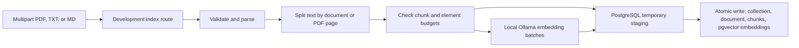
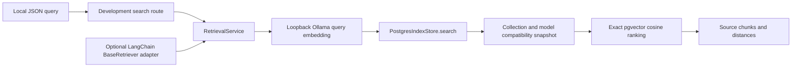

# Codebase map

This map describes the implemented Python backend on the current branch. Check the linked code when changing behavior; [architecture decisions](ARCHITECTURE_DECISIONS.md) explain the broader direction and [the roadmap](ROADMAP.md) separates later phases.

## Entry points and boundaries

| Area | Current responsibility |
| --- | --- |
| [`src/rag_ai/main.py`](../src/rag_ai/main.py) | `create_app()` builds FastAPI, stores validated settings, always registers `/health`, and registers document routes only with explicit development flags. |
| [`src/rag_ai/core/config.py`](../src/rag_ai/core/config.py) | Pydantic settings load environment values, validate resource limits and the loopback Ollama URL, and reject production document-route opt-in. |
| [`src/rag_ai/api/`](../src/rag_ai/api/) | `/health` is process liveness. Parse/chunk routes return extracted content; the index route persists an index; `retrieval.py` exposes JSON search. All document routes are development-only and disabled by default. |
| [`src/rag_ai/documents/`](../src/rag_ai/documents/) | `parser.py` validates uploads and extracts text; `chunker.py` uses LangChain's `RecursiveCharacterTextSplitter`; `indexer.py` coordinates bounded embedding batches and storage. |
| [`src/rag_ai/embeddings/`](../src/rag_ai/embeddings/) | `base.py` defines an `EmbeddingProvider` protocol and batch model; `ollama.py` implements local embeddings through Ollama HTTP. |
| [`src/rag_ai/retrieval/`](../src/rag_ai/retrieval/) | `service.py` embeds and validates one query, `models.py` defines results, `langchain.py` adapts the service to `BaseRetriever`, and `evaluation.py` scores ranked IDs. |
| [`src/rag_ai/generation/`](../src/rag_ai/generation/) | Typed structured-output contract and local Ollama `/api/chat` provider. |
| [`src/rag_ai/rag/`](../src/rag_ai/rag/) | Bounded evidence context, prompt instructions, and single-turn retrieval/generation/citation coordination. |
| [`src/rag_ai/storage/`](../src/rag_ai/storage/) | `postgres.py` writes collection-scoped records and performs read-only exact cosine search. `migrate.py`, `__main__.py`, and `migrations/0001_initial.sql` provide explicit versioned schema commands. |

## Implemented indexing flow

The route in `api/documents.py` reads a bounded upload, then calls `parse_document`, `chunk_document`, and `index_document`. PDFs use PyMuPDF page text; TXT and Markdown use UTF-8. `ParsedDocument` holds the SHA-256 content ID, filename, type, text, and PDF page metadata. `ChunkedDocument` holds ordered chunks with deterministic IDs; PDF chunks retain page numbers. The indexer asks `EmbeddingProvider` for batches of at most 16, validates the first response's actual dimensions and total element budget, then streams remaining batches to `PostgresIndexStore`.

`OllamaEmbeddingProvider` checks the local model digest through `/api/tags` and obtains vectors through `/api/embed`. It validates model identity, revision, dimensions, and vector values. `PostgresIndexStore` uses parameterized SQL, a connection-local temporary table, and a final transaction to replace one document's chunks and embeddings within its collection. The schema stores original bytes and model metadata; composite foreign keys bind chunks and vectors to their collection. Storage-layer `delete_document` cascades derived rows for one collection, but there is no HTTP deletion route.

## Implemented retrieval flow

`api/retrieval.py` calls the synchronous service in a threadpool and closes the Ollama provider after each request. The service validates one nonzero query vector and passes its measured model name, digest, and dimensions to the existing store. The store checks actual indexed embeddings and ranks only materialized, same-dimension, same-model, nonzero candidates in one read-only repeatable-read transaction. It fetches chunk text only for the top ranked IDs. SQL joins and filters include `collection_id`; returned results carry filename and PDF page metadata but no raw vectors. The LangChain adapter delegates to the same service. `evaluation.py` calculates Recall@K, Hit@K, and MRR from actual ranked IDs; the separate nine-document synthetic fixture tests ranking at K=1 and K=3.

Migrations do not run at API startup. `python -m rag_ai.storage status|upgrade|adopt-legacy` invokes the migration runner; `0001_initial.sql` is the current version. Existing unversioned Phase 4 databases require backup and explicit verified adoption. See [database migrations](DATABASE_MIGRATIONS.md).

## Trust boundaries and tests

Uploads, filenames, MIME types, PDF structure, Ollama responses, and database state cross trust boundaries. The provider accepts loopback HTTP only and rejects redirects; there is no cloud fallback. Development route gating is **not** authentication or collection authorization. Keep these routes on a trusted localhost machine; see the [security test plan](SECURITY_TEST_PLAN.md).

Use `tests/test_health.py` and `tests/test_document_gate.py` for routing and configuration gates; `tests/test_documents.py` for parsing; `tests/test_chunking.py` for splitting; `tests/test_embeddings.py` for provider/indexer behavior; `tests/test_retrieval.py` for service, adapter, and API behavior; and `tests/test_retrieval_evaluation.py` for metrics. `tests/test_storage_lifecycle.py`, `tests/test_indexing_integration.py`, and `tests/test_retrieval_integration.py` cover opt-in PostgreSQL/Ollama paths. `tests/conftest.py` creates disposable schemas for live database tests. The default suite skips those tests without the explicit test database setting.

The local 2026-10-29 run used the dedicated `rag_ai_retrieval_test` database and `embeddinggemma:300m`: seven retrieval integration tests and the five-test expanded evaluation module passed. The full suite passed 168 tests with no skips. This validates the current Linux setup only; it does not establish cross-platform or production behavior.

## Implemented cited-answer flow

`api/answers.py` runs `RAGService.answer()` in a threadpool and closes both providers. `RAGService` reuses `RetrievalService`; `rag/context.py` assigns request-local labels to ranked chunks and rejects overlong evidence rather than truncating it. `rag/prompts.py` presents untrusted content as delimited evidence. `generation/ollama.py` requests JSON-schema output from local Ollama, validates the returned status and claims, and bounds the response. `RAGService` resolves cited labels to retrieval metadata and rejects unknown labels. Empty retrieval abstains without generation. The application verifies provenance, not entailment. `tests/test_generation.py`, `tests/test_rag_service.py`, `tests/test_answer_api.py`, and opt-in `tests/test_rag_integration.py` cover this flow with synthetic data.

## Planned, not implemented

Cloud providers and multimodal processing, LangGraph workflows, MCP tools, and the React frontend remain roadmap items. Caller/document authorization is also not implemented.
