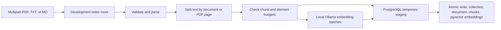

# Codebase map

This map describes the implemented Python backend on the current branch. Check the linked code when changing behavior; [architecture decisions](ARCHITECTURE_DECISIONS.md) explain the broader direction and [the roadmap](ROADMAP.md) separates later phases.

## Entry points and boundaries

| Area | Current responsibility |
| --- | --- |
| [`src/rag_ai/main.py`](../src/rag_ai/main.py) | `create_app()` builds FastAPI, stores validated settings, always registers `/health`, and registers document routes only with explicit development flags. |
| [`src/rag_ai/core/config.py`](../src/rag_ai/core/config.py) | Pydantic settings load environment values, validate resource limits and the loopback Ollama URL, and reject production document-route opt-in. |
| [`src/rag_ai/api/`](../src/rag_ai/api/) | `/health` is process liveness. `/documents/parse` and `/documents/chunk` return extracted content without persistence; `/collections/{collection_id}/documents/index` persists an index. Document routes are development-only and disabled by default. |
| [`src/rag_ai/documents/`](../src/rag_ai/documents/) | `parser.py` validates uploads and extracts text; `chunker.py` uses LangChain's `RecursiveCharacterTextSplitter`; `indexer.py` coordinates bounded embedding batches and storage. |
| [`src/rag_ai/embeddings/`](../src/rag_ai/embeddings/) | `base.py` defines an `EmbeddingProvider` protocol and batch model; `ollama.py` implements local embeddings through Ollama HTTP. |
| [`src/rag_ai/storage/`](../src/rag_ai/storage/) | `postgres.py` stages vectors and atomically writes collection-scoped records. `migrate.py`, `__main__.py`, and `migrations/0001_initial.sql` provide explicit versioned schema commands. |

## Implemented indexing flow

The route in `api/documents.py` reads a bounded upload, then calls `parse_document`, `chunk_document`, and `index_document`. PDFs use PyMuPDF page text; TXT and Markdown use UTF-8. `ParsedDocument` holds the SHA-256 content ID, filename, type, text, and PDF page metadata. `ChunkedDocument` holds ordered chunks with deterministic IDs; PDF chunks retain page numbers. The indexer asks `EmbeddingProvider` for batches of at most 16, validates the first response's actual dimensions and total element budget, then streams remaining batches to `PostgresIndexStore`.

`OllamaEmbeddingProvider` checks the local model digest through `/api/tags` and obtains vectors through `/api/embed`. It validates model identity, revision, dimensions, and vector values. `PostgresIndexStore` uses parameterized SQL, a connection-local temporary table, and a final transaction to replace one document's chunks and embeddings within its collection. The schema stores original bytes and model metadata; composite foreign keys bind chunks and vectors to their collection. Storage-layer `delete_document` cascades derived rows for one collection, but there is no HTTP deletion route.

Migrations do not run at API startup. `python -m rag_ai.storage status|upgrade|adopt-legacy` invokes the migration runner; `0001_initial.sql` is the current version. Existing unversioned Phase 4 databases require backup and explicit verified adoption. See [database migrations](DATABASE_MIGRATIONS.md).

## Trust boundaries and tests

Uploads, filenames, MIME types, PDF structure, Ollama responses, and database state cross trust boundaries. The provider accepts loopback HTTP only and rejects redirects; there is no cloud fallback. Development route gating is **not** authentication or collection authorization. Keep these routes on a trusted localhost machine; see the [security test plan](SECURITY_TEST_PLAN.md).

Use `tests/test_health.py` and `tests/test_document_gate.py` for routing and configuration gates; `tests/test_documents.py` for parsing; `tests/test_chunking.py` for splitting; `tests/test_embeddings.py` for provider and indexer behavior; and `tests/test_storage_lifecycle.py` plus `tests/test_indexing_integration.py` for opt-in PostgreSQL/Ollama paths. `tests/conftest.py` creates disposable schemas for live database tests. The default suite skips those tests without the explicit test database setting.

## Planned, not implemented

Phase 5 semantic retrieval and evaluation, Phase 6 answer generation with citations, later cloud providers and multimodal processing, LangGraph workflows, MCP tools, and the React frontend are roadmap items. The current code stores vectors but does not search them or generate answers.
