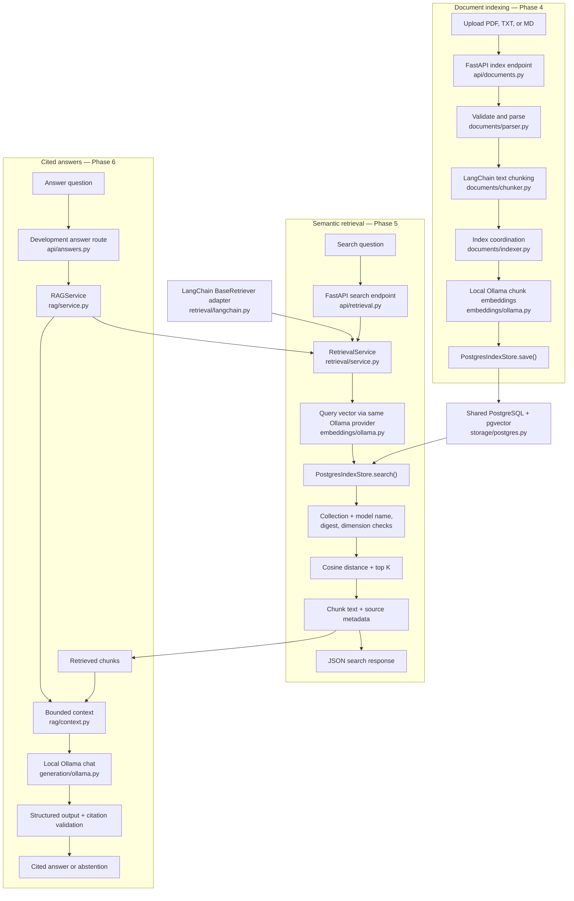

# RAG-AI development roadmap

This roadmap separates merged code, current branch work, and plans. Phases 1–6, 8, 9A.1, 9A.2, and 9B.1 are merged on `main`. Phase 9B.2 is feature-branch work on `feat/combined-multimodal-retrieval`. A small Phase 8 `qwen3-vl:4b-instruct` evaluation returned HTTP 200 for 15 requests but exposed interpretation errors; see the [local testing guide](LOCAL_RAG_TESTING.md#phase-8-visual-testing-on-main). It is not an accuracy benchmark.

| Phase | Status | Intended outcome |
| --- | --- | --- |
| 1. Backend foundation | Complete | FastAPI health API, typed configuration, tests, and local PostgreSQL with pgvector configuration. The API does not yet use the database. |
| 2. Document ingestion | Complete | Development-only PDF, TXT, and Markdown extraction with metadata and input limits; no persistence. |
| 3. Document chunking | Complete | Development-only LangChain text splitting with source-page metadata, deterministic IDs, and resource bounds; no persistence. |
| 4. Local embeddings and pgvector | Complete for local development | Use native local Ollama at a configurable loopback endpoint and store collection-scoped original documents, chunks, vectors, model names, digests, and measured dimensions in PostgreSQL/pgvector via Docker Compose. Explicit versioned migrations and storage-layer document deletion exist; indexing is development-only and has no collection authorization. |
| 5. Semantic retrieval and evaluation | Complete for local development | Development-only collection-scoped exact cosine search, model compatibility checks, a LangChain adapter, and a separate synthetic evaluation dataset. Caller/document authorization remains unimplemented. |
| 6. Local text RAG with citations | On `main`; local E2E merged | Generate text answers locally from retrieved evidence and cite traceable source locations; handle insufficient evidence explicitly. |
| 7. Multi-provider LLM and embedding support | Planned | Add independent embedding and LLM interfaces for local Ollama and explicitly authorized cloud AI providers, with explicit local/cloud processing policies. Confidential data must never fall back to a cloud provider automatically. |
| 8. Multimodal document understanding | Complete for local development on `main` | Inspect embedded images, vector paths, and heuristic tables; render bounded PDF pages/regions; locally interpret PDF regions and PNG/JPEG files with application-owned provenance. No OCR guarantee or semantic verification. |
| 9A.1. Visual metadata persistence | Merged on `main` | Store and list bounded source occurrences from already indexed PDFs, scoped to collection and document. No model inference. |
| 9A.2. Visual interpretation persistence | Merged on `main` | Persist immutable local model interpretations with source, prompt, rendered-image, and model-digest provenance. |
| 9B.1. Local visual semantic retrieval | Merged | Embed persisted interpretation descriptions and observations locally; search compatible vectors with source coordinates and unverified status. |
| 9B.2. Combined text and visual retrieval | Feature-branch work, pending review | One query embedding and one database snapshot for both candidate sets; deterministic RRF and typed source provenance. No answer generation. |
| 10. LangGraph agentic workflows | Planned | Add bounded, observable workflows only where they improve a defined user task; enforce tool and data permissions. |
| 11. MCP tool integration | Planned | Expose or consume approved tools through MCP with explicit scopes, validation, and audit controls. |
| 12. React frontend | Planned | Build a user interface for authorized document and answer workflows, including citation inspection. |
| 13. Deployment and security hardening | Planned | Complete deployment controls, access enforcement, resource isolation, observability safeguards, and operational validation. Public document processing remains blocked until its security requirements are met. |

## Cross-phase acceptance principles

- Develop locally first and keep provider selection explicit. Design embedding, LLM, and vision boundaries so a later provider can be added without changing document ownership rules.
- Target a cross-platform Python backend on Windows, macOS, and Linux. Ollama runs natively for local inference, with CPU or supported GPU use according to host hardware. Keep PostgreSQL/pgvector in Docker Compose and document platform-specific setup. RAG-AI selects a configurable loopback Ollama endpoint and does not silently switch to a cloud endpoint.
- Keep stored documents scoped to a collection; add collection authorization before any shared or public access and enforce it in storage and retrieval. Record embedding model name, Ollama digest, and measured vector dimensions so incompatible vectors are not mixed silently.
- Preserve original source bytes and traceable locations for future citations. Treat extracted text, images, diagrams, and tables as untrusted data.
- Use separate development and evaluation datasets. Automated tests use synthetic data; evaluation data must have documented rights and handling rules before use.
- Add functional and security tests for each new attack surface. Do not treat a completed phase or passing tests as a production security approval.
- Add automated Windows, macOS, and Linux test coverage as integrations arrive. Keep development fixtures separate from evaluation datasets and record platform-specific limitations rather than assuming parity.

Phase 6 adds single-turn local answers from retrieved text with application-resolved citations and explicit abstention. Phase 8 visual processing remains separate from text-RAG. Phases 9A.1 and 9A.2 persist source metadata and unverified local interpretations. Phase 9B.1 searches text embeddings of those interpretations. Phase 9B.2 combines retrieval results; visual answer citations and true image-based search remain future work. Public document access remains blocked by missing authentication, authorization, ingress limits, and stronger resource isolation.

The merged PDF-to-answer path has a reproducible [manual and automated test](LOCAL_RAG_TESTING.md). Hardware-aware installation, Docker/Podman support, cross-platform packaging, and release documentation remain future requirements; the local E2E test does not establish them.

## Application flow

All document routes are for trusted localhost development. Collection filtering and model compatibility protect search correctness; they do not authenticate callers. The LangChain adapter delegates to the same retrieval service. RAGService also reuses that service, then sends bounded evidence to local Ollama and resolves cited labels against retrieved chunks; citation validity alone does not prove factual support.

Phase 8 has two analysis inputs: **PDF upload → bounded page/region render → local Ollama vision** and **PNG/JPEG upload → bounded image validation → local Ollama vision**. Phase 9A.1 separately takes an indexed PDF from PostgreSQL, verifies its bytes, extracts bounded visual metadata, and replaces its visual-element set transactionally. Phase 9A.2 analyzes one stored element locally and persists an immutable, unverified interpretation. Phase 9B.1 embeds that interpretation's text; Phase 9B.2 retrieves text and interpretation candidates together. These paths do not feed the text-RAG answer endpoint. ZIP/bulk ingestion is a separate future capability.
