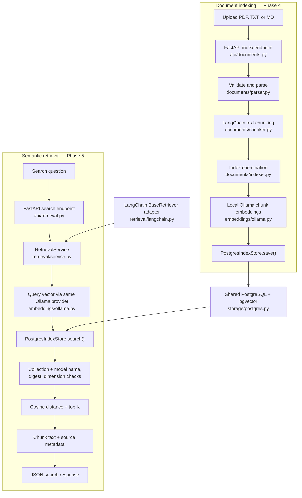

# RAG-AI development roadmap

This roadmap records the approved development direction. Phases 1–4 are implemented for local development; Phase 5 is implemented and locally tested on `feat/semantic-retrieval`, pending final human review. Later phases are plans, not current capabilities. Each phase requires its own scoped branch, tests, security review, and documentation before merge. See [architecture decisions](ARCHITECTURE_DECISIONS.md) and the [security test plan](SECURITY_TEST_PLAN.md).

| Phase | Status | Intended outcome |
| --- | --- | --- |
| 1. Backend foundation | Complete | FastAPI health API, typed configuration, tests, and local PostgreSQL with pgvector configuration. The API does not yet use the database. |
| 2. Document ingestion | Complete | Development-only PDF, TXT, and Markdown extraction with metadata and input limits; no persistence. |
| 3. Document chunking | Complete | Development-only LangChain text splitting with source-page metadata, deterministic IDs, and resource bounds; no persistence. |
| 4. Local embeddings and pgvector | Complete for local development | Use native local Ollama at a configurable loopback endpoint and store collection-scoped original documents, chunks, vectors, model names, digests, and measured dimensions in PostgreSQL/pgvector via Docker Compose. Explicit versioned migrations and storage-layer document deletion exist; indexing is development-only and has no collection authorization. |
| 5. Semantic retrieval and evaluation | Implemented and locally verified on feature branch; human review pending | Development-only collection-scoped exact cosine search, model compatibility checks, a LangChain adapter, and a separate synthetic evaluation dataset. Caller/document authorization remains unimplemented. |
| 6. Local text RAG with citations | Planned | Generate text answers locally from retrieved evidence and cite traceable source locations; handle insufficient evidence explicitly. |
| 7. Multi-provider LLM and embedding support | Planned | Add independent embedding and LLM interfaces for local Ollama and explicitly authorized cloud AI providers, with explicit local/cloud processing policies. Confidential data must never fall back to a cloud provider automatically. |
| 8. Multimodal document understanding | Planned | Add an independent vision-language model (VLM) interface; extract and represent multimodal PDFs, images, figures, diagrams, and tables while preserving links to original source files and page or region locations. |
| 9. Multimodal RAG and visual citations | Planned | Retrieve text and visual evidence and return citations that identify the original visual source. |
| 10. LangGraph agentic workflows | Planned | Add bounded, observable workflows only where they improve a defined user task; enforce tool and data permissions. |
| 11. MCP tool integration | Planned | Expose or consume approved tools through MCP with explicit scopes, validation, and audit controls. |
| 12. React frontend | Planned | Build a user interface for authorized document and answer workflows, including citation inspection. |
| 13. Deployment and security hardening | Planned | Complete deployment controls, access enforcement, resource isolation, observability safeguards, and operational validation. Public document processing remains blocked until its security requirements are met. |

## Cross-phase acceptance principles

- Develop locally first and keep provider selection explicit. Design embedding, LLM, and vision boundaries so a later provider can be added without changing document ownership rules.
- Target a cross-platform Python backend on Windows, macOS, and Linux. Ollama runs natively for local inference, with CPU or supported GPU use according to host hardware. Keep PostgreSQL/pgvector in Docker Compose and document platform-specific setup. RAG-AI selects a configurable loopback Ollama endpoint and does not silently switch to a cloud endpoint.
- Keep stored documents scoped to a collection; add collection authorization before any shared or public access and enforce it in storage and retrieval. Record embedding model name, Ollama digest, and measured vector dimensions so incompatible vectors are not mixed silently.
- Preserve original source bytes and traceable locations for future citations. Treat extracted text, images, diagrams, and tables as untrusted data.
- Use separate development and evaluation datasets. Automated tests use synthetic data; evaluation data must have documented rights and handling rules before use.
- Add functional and security tests for each new attack surface. Do not treat a completed phase or passing tests as a production security approval.
- Add automated Windows, macOS, and Linux test coverage as integrations arrive. Keep development fixtures separate from evaluation datasets and record platform-specific limitations rather than assuming parity.

The next planned implementation milestone is Phase 6, only when separately requested after Phase 5 review. Phase 5 searches stored vectors but does not generate answers, support multimodal processing, agents, MCP integration, or a frontend. Public indexing and retrieval remain blocked by missing authentication, authorization, ingress limits, and stronger resource isolation.

## Application flow

Both routes are for trusted localhost development. Collection filtering and model compatibility protect search correctness; they do not authenticate callers. The LangChain adapter delegates to the same service and does not perform a second vector search. Answer generation remains planned for Phase 6.
